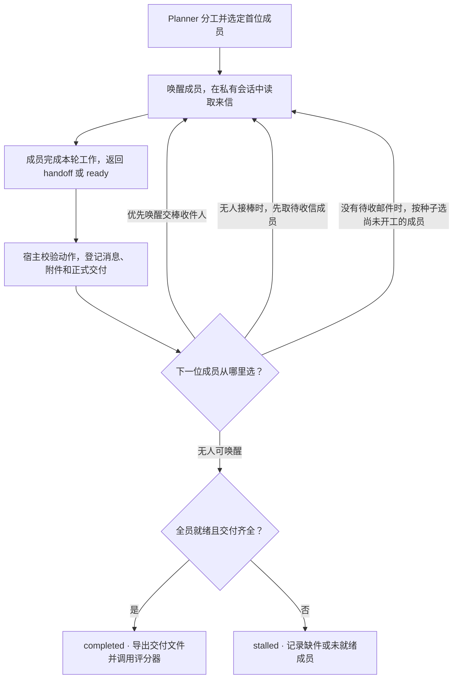

# Team Memory Eval

团队成员按顺序完成一道研究题。每轮只有一名成员工作，通过 `handoff` 把消息和附件发给下一位，通过 `ready` 收工并提交文件。另有两个独立对照入口，分别调用 Codex CLI 的原生子代理和 MARBLE 官方运行器。[P2P 回合与交付](docs/point-to-point.md)

## 从 GitHub 接收

交付分支为 `dev/deepseek`。以下命令只取该分支当前提交。交接时用发布方给出的完整提交号核对最后一行，记下这个版本即可定位同一套运行代码、配置、逐题命令和实验记录。

```bash
git clone --depth 1 --single-branch --branch dev/deepseek https://github.com/Jerry-723/team-memory-eval.git
cd team-memory-eval
git rev-parse HEAD
```

本次交付五组基线，每组有三道题的历史结果和可复制命令。

| 场景 | 基线 | 题号 | 工作模型 |
| --- | --- | --- | --- |
| MARBLE Research，七项工具 | Codex 原生子代理、MARBLE 官方框架、TME 顺序 P2P | research/1、2、3 | `gpt-5.6-luna` |
| Work，DRBench Docker App | Codex 原生子代理、TME 动态名册顺序 P2P | DR0001、DR0002、DR0003 | `gpt-6-luna` |

[五组实验怎么跑](#五组实验怎么跑) · [15 条逐题运行命令](docs/historical-commands.md) · [逐题结果](experiments/baseline-results.csv) · [交接清单](docs/LONGCOLLAB_HANDOFF.md)

## P2P 如何交棒

Planner 读 MARBLE 原题名册，或按 DRBench 题目生成名册，再分工并指定首位成员。之后，成员可以在自己的回合里多次查资料、调用工具或写文件。当前容器退出、动作校验通过后，宿主才唤醒下一位。



例如，A 把草稿交给 B 并声明自己就绪。B 带着修改意见回信并就绪，来信会再次唤醒 A。A 恢复原会话，上传定稿，在 `ready` 动作的 `submissions` 中填入文件 ID，宿主据此确认正式交付。回合数或 token 预算耗尽时，运行可提前以 `budget_exhausted` 结束。[交棒实现](runtime/envs/point_to_point.py) · [A → B → A 的回归测试](tests/test_team.py)

## 环境和原题

宿主使用 Python 3.12。宿主依赖、离线测试和研究工具依赖见 [pyproject.toml](pyproject.toml)。下面的命令从本项目根目录执行，`PY` 指向项目环境中的 Python。只需准备本次使用的基准，加载器会核对上游提交。

```bash
PY="$HOME/miniconda3/envs/team-memory-eval/bin/python"
export TME_REFERENCE_REPOS="${TME_REFERENCE_REPOS:-$PWD/experiments/upstream}"
mkdir -p "$TME_REFERENCE_REPOS"
git clone https://github.com/ulab-uiuc/MARBLE.git "$TME_REFERENCE_REPOS/MARBLE"
git -C "$TME_REFERENCE_REPOS/MARBLE" checkout --detach eae9f15e5b9f1e808f8ff61800b129d5538c1b47
git clone https://github.com/ServiceNow/drbench.git "$TME_REFERENCE_REPOS/drbench"
git -C "$TME_REFERENCE_REPOS/drbench" checkout --detach 0d699ecf6aa96b1de378595b432e9b16a82f0ed9
```

已有检出时可直接设置 `TME_REFERENCE_REPOS`。额外的宿主工具依赖可通过 `TME_BENCHMARK_DEPS` 指定。P2P 和 Codex 对照使用 Docker。TME 的 Codex 成员使用 `tme-codex:b1`。历史原生组把宿主 Codex 挂入 `tme-claude-code:b1`。Codex 的构建目录需包含 Linux standalone 0.166.0 的三个可执行文件。

```bash
docker build --pull=false -t tme-claude-code:b1 -f images/claude-code.Dockerfile images
CODEX_BIN_DIR=$(dirname "$(readlink -f "$(command -v codex)")")
docker build --pull=false -t tme-codex:b1 -f - "$CODEX_BIN_DIR" < images/codex.Dockerfile
```

<a id="运行-p2p"></a>

## 五组实验怎么跑

以下命令各跑三题。在仓库根目录打开 Bash，先完成上面的环境准备，再在同一终端执行共用设置和所选实验。请先导出成员服务的 `OPENAI_BASE_URL`、`OPENAI_API_KEY` 和评委的 `TME_JUDGE_BASE_URL`、`TME_JUDGE_API_KEY`。五组均以 `gpt-5.6-terra` 评分。成员服务需支持 Codex 的流式 Responses 和 Planner 的 Chat Completions。[依赖、镜像 ID 和服务条件](docs/baseline-reproduction.md#2-准备上游环境和历史配置)

```bash
PY="$HOME/miniconda3/envs/team-memory-eval/bin/python"
H="$PWD/experiments/history"
OUT=$(mktemp -d /tmp/tme-five-runs-XXXXXXXX)
export TME_REFERENCE_REPOS="${TME_REFERENCE_REPOS:-$PWD/experiments/upstream}"
export TME_BENCHMARK_DEPS="${TME_BENCHMARK_DEPS:-$PWD/experiments/benchmark-deps}"
export PYTHONPATH="$TME_BENCHMARK_DEPS${PYTHONPATH:+:$PYTHONPATH}"
export CUDA_VISIBLE_DEVICES="" LITELLM_LOCAL_MODEL_COST_MAP=True
bash "$H/prepare-source.sh" seven "$OUT/seven"
bash "$H/prepare-source.sh" work "$OUT/work"
```

`$OUT/seven` 和 `$OUT/work` 从本次检出组装历史启动器。历史原生组将宿主 Codex CLI `0.166.0` 挂入 `tme-claude-code:b1`。交付根目录也提供内置同版 CLI 的启动器。下面按历史方式复跑，每组的输出各占一个新目录。

### 1. MARBLE Research · Codex 原生子代理

使用宿主文件版 ChatGPT 登录。每题独立启动一个主会话，工作模型为 `gpt-5.6-luna`，推理档为 `high`，每题超时 5,400 秒。生成成功后，把三份答案一次交给独立评委。

```bash
A="$OUT/marble-codex"
printf '%s\n' 1 2 3 | xargs -P 3 -I '{}' "$PY" "$OUT/seven/experiments/run_codex_research.py" \
  --tasks '{}' --mode native --model gpt-5.6-luna --effort high --auth chatgpt \
  --timeout 5400 --output "$A/task-{}" &&
"$PY" -m eval.score --config "$H/configs/research-56.yaml" --judge-model gpt-5.6-terra \
  --output "$A/scores.json" "$A/task-1/research-1/answer.jsonl" \
  "$A/task-2/research-2/answer.jsonl" "$A/task-3/research-3/answer.jsonl"
```

历史三题均注册七项工具，含 `fetch_webpage`，主会话分别创建了 5、5、3 个直属子代理。逐题查看 `task-N/research-N/` 下的 `run.json`、`events.jsonl`、`idea` 和 `answer.jsonl`，整批评分在 `$A/scores.json`。[历史运行参数和评分](experiments/history/cases/marble-native-gpt-5.6-luna-7tools)

### 2. MARBLE Research · MARBLE 官方框架

在固定提交的 MARBLE **上游仓库根目录**使用官方脚本。采用原题七工具环境、`graph` 协作和最多 5 轮。LiteLLM 使用 `OPENAI_API_BASE`，同一份 `OPENAI_API_KEY` 需能调用工作模型和评委。

```bash
(cd "$TME_REFERENCE_REPOS/MARBLE" && OPENAI_API_BASE="$OPENAI_BASE_URL" \
  "$PY" scripts/run_benchmark.py --scenario research --task_ids 1-3 \
  --model openai/gpt-5.6-luna --eval_model openai/gpt-5.6-terra \
  --coordinate_mode graph --max_iterations 5 --output_dir "$OUT/marble-official" --overwrite)
```

官方引擎在运行中评分。查看 `$OUT/marble-official/research/openai_gpt-5.6-luna/` 下的逐题 `results.jsonl` 和整批 `summary.json`。[归档汇总](experiments/history/official/luna-research)

### 3. MARBLE Research · TME 顺序 P2P

```bash
"$PY" run.py --config "$H/configs/research-56.yaml" --runner tme --output "$OUT/marble-tme"
```

配置选取 Research 1、2、3，成员使用 `gpt-5.6-luna` 和原生默认推理档。三题按原题分别建 5、5、3 人名册，成员使用七项研究工具，一次只唤醒一人。历史分别完成 9、8、6 个回合。每题在 `$OUT/marble-tme/` 下生成自己的目录，正式交付在 `submissions/idea`，自动评分在 `scores.json`。[历史名册与轨迹](experiments/history/cases/marble-p2p-gpt-5.6-luna)

### 4. Work · DRBench Docker + Codex 原生子代理

Work 两组都需导出 `SERPER_API_KEY`，模型服务还需提供 `text-embedding-ada-002`。先准备与归档一致的 DRBench 企业应用镜像。宿主为 DR0001、DR0002、DR0003 各启动一个上游 App 容器。[固定镜像摘要](docs/baseline-reproduction.md#2-准备上游环境和历史配置)

```bash
"$PY" -u "$OUT/work/run.py" --config "$H/configs/work.yaml" --runner codex-native --output "$OUT/work-codex"
```

主会话使用 `gpt-6-luna`、`high`，通过 Codex 原生子代理派工并调用 App 工具，历史三题各创建两个直属子代理。查看 `$OUT/work-codex/` 下每题的 `submissions/report.json` 和 `scores.json`。历史 DR0003 首次评分遇到 `RemoteProtocolError`，随后对同一份报告重评得 20%。若要复现这次补评，可直接用归档原报告调用官方评分器。

```bash
"$PY" -m experiments.history.rescore_work "$H/configs/work.yaml" DR0003 \
  "$H/cases/drbench-codex-native-gpt-6-luna/DR0003/report.json" > "$OUT/work-DR0003-rescore.json"
```

### 5. Work · DRBench Docker + TME 顺序 P2P

```bash
"$PY" -u "$OUT/work/run.py" --config "$H/configs/work.yaml" --runner tme --output "$OUT/work-tme"
```

使用与上一组相同的题目、App、工作模型和推理档。Planner 为每题动态建队，历史三题均生成三人，分别完成 4、5、4 个回合。查看 `$OUT/work-tme/` 下每题的 `plan.json`、`events.jsonl`、`submissions/report.json` 和 `scores.json`。两组 Work 都用 DRBench 的 `insights_recall` 评分。[历史名册、轨迹和报告](experiments/history/cases/drbench-p2p-gpt-6-luna)

单独复跑某道题或补评 Work 原报告，可直接使用对应的逐题命令。[15 条逐题命令](docs/historical-commands.md) · [历史结果表](experiments/baseline-results.csv)

## 验证与回放

```bash
"$PY" -m pytest -q
"$PY" -m tools.visualization
```

要核对当前运行源码与已验收版本，可用同一提交里的验收记录校验 47 个文件，覆盖 P2P、Codex、场景适配器、镜像定义及实验配置。

```bash
"$PY" - <<'PYCODE'
import hashlib, json
from pathlib import Path

files = json.loads(Path("tests/sdk_verification/results/handoff-check.json").read_text())["runtime_files_sha256"]
for name, expected in files.items():
    if hashlib.sha256(Path(name).read_bytes()).hexdigest() != expected:
        raise SystemExit(f"文件与验收记录不符 {name}")
print(f"{len(files)} 个文件与验收记录一致")
PYCODE
```

默认测试使用脚本端点。[SDK 验证清单](docs/sdk-verification.md)

打开 `http://127.0.0.1:8765`，从左侧选一次运行。要核对 B 为什么在 A 之后接棒，在 `events.jsonl` 里找到 A 的 `committed` 事件，查看它的 `action` 和 `next`，再对照 B 的 `activated` 事件中的 `reason` 和来信编号。

| 想核对什么 | 在本次运行目录中查看 |
| --- | --- |
| 谁先开工，各成员负责什么 | `plan.json` 中的 `first_member` 和 `members` |
| 某份文件是否正式交付 | `events.jsonl` 中的 `submitted` 事件以及 `submissions/` 下的最终文件 |
| 执行为何结束，评分是否成功 | `result.json` 记录执行状态与用量，`scores.json` 记录评分结果或错误 |
